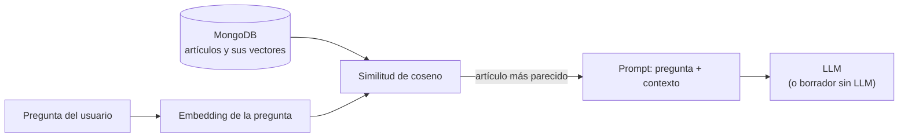

# Lecture 10: datos no estructurados y bases NoSQL (MongoDB)

<div align="justify">

Práctica del Módulo 2 de Henry Data Science, con **MongoDB** (en Docker), **MongoDB Compass** y **Python**. La carpeta reúne dos trabajos que siguen el mismo procedimiento:

1. **Ejemplo práctico de la lecture: asistente de conocimiento.** Muestra el procedimiento completo con un dataset de 5 artículos: importar, crear índices, buscar por palabra clave, agregar y vectorizar el texto para una búsqueda por significado.
2. **Homework: tienda virtual.** Aplica el mismo procedimiento a la consigna de la entrega, con 100 productos: CRUD, índices, agregación y extra mile.

## Contenido

| Archivo | Qué es |
|---|---|
| `M2_L10_asistente_conocimiento_laroga.js` | Ejemplo de la lecture: comandos de la consola de MongoDB |
| `M2_L10_tienda_virtual_laroga.js` | Homework: comandos de la consola de MongoDB |
| `data/articulos_conocimiento.csv` | Dataset de la clase: 5 artículos breves de conocimiento |
| `data/articulos.json` | El mismo dataset convertido a JSON para importarlo, con el `id` como `_id` |
| `data/productos.json` | 100 productos sintéticos para el homework |
| `python/consulta_articulos.py` | Consulta los artículos desde Python: por categoría y por palabra clave |
| `python/busqueda_semantica.py` | Embeddings de los artículos, búsqueda por similitud y prompt para un LLM |
| `python/requirements.txt` | Librerías de los scripts |
| `capturas/` | Capturas de cada paso (ver abajo) |

## Herramientas y puesta en marcha

| Pieza | Qué es | Equivalente en las lectures SQL |
|---|---|---|
| Contenedor `mongodb` en Docker | El motor, donde viven los datos | El contenedor `postgres` |
| MongoDB Compass | El cliente para explorar, importar y consultar | DBeaver |
| Consola de Compass (*Open MongoDB shell*) | Donde se escriben los comandos | El editor SQL |

```bash
# MongoDB 8.0 en Docker; el volumen conserva los datos si se apaga el contenedor
docker run -d --name mongodb -p 27017:27017 -v mongodb_data:/data/db mongo:8.0
```

En Compass: **Add new connection** → `mongodb://localhost:27017` → **Save & Connect**. Para crear una base, el **+** junto a la conexión; en MongoDB una base se crea junto con su primera colección. Para importar, en la colección: **ADD DATA → Import JSON or CSV file**.

Los comandos de cada archivo `.js` se ejecutan en la consola **de a una línea**, con Enter.

---

## Ejemplo práctico de la lecture: asistente de conocimiento

### El caso

Un asistente inteligente responde preguntas de usuarios a partir de una base de artículos breves sobre temas cotidianos: recetas, jardinería, trámites, finanzas y búsqueda laboral. La pregunta central es qué tipo de base usar para guardar los artículos y **recuperar información útil aunque el usuario no sepa cómo preguntar**.

La solución combina dos capas:



- **MongoDB** guarda, consulta y administra los artículos.
- **Una capa vectorial** representa cada texto como un vector de números y busca por significado. Es la base de un sistema **RAG** (*retrieval-augmented generation*): el LLM responde a partir del artículo recuperado, no solo de lo que sabe.

### Por qué MongoDB

- **Estructura flexible.** Cada artículo es un documento JSON. Si mañana un artículo trae etiquetas, autor o un vector de embeddings, se agrega el campo sin modificar un esquema. En este trabajo, el campo `embedding` se agregó después de la carga, sin cambiar nada más.
- **Búsquedas simples y eficientes.** Los índices sobre `categoria` y el índice de texto sobre `contenido` resuelven las consultas por categoría y por palabra clave.

### Por qué BASE y no ACID

| | ACID (bases relacionales) | BASE (MongoDB y otras NoSQL) |
|---|---|---|
| Prioridad | Que cada transacción sea exacta y se vea completa al instante | Que el sistema esté siempre disponible y escale |
| Consistencia | Inmediata | **Eventual**: los cambios se propagan en poco tiempo |
| Caso típico | Un pago, una transferencia, un stock que no puede quedar negativo | Un catálogo, un feed, una base de artículos |

En este caso BASE es preferible:

- **La consistencia eventual no afecta la calidad.** Si un artículo nuevo tarda unos segundos en aparecer en las búsquedas, ninguna respuesta queda mal. No hay dinero ni stock en juego.
- **Importan más la flexibilidad y la escala.** Los artículos cambian de forma y se suman de a miles; lo que se necesita es leer rápido y agregar campos sin migraciones, no coordinar transacciones entre varias tablas.

### Índices

| Índice | Para qué |
|---|---|
| `categoria_1` (simple) | Filtrar rápido por categoría |
| `categoria_1_titulo_1` (compuesto) | Buscar por categoría y título; también sirve para buscar solo por categoría, su primer campo |
| `contenido_text` (de texto, en español) | Buscar palabras dentro del contenido |

El índice de texto en español ignora las tildes y las palabras sin contenido (*de*, *la*, *y*) y reduce cada palabra a su raíz:

- **"curriculum"**, sin tilde, encuentra *Cómo redactar un currículum efectivo*.
- **"cultivo"** encuentra la guía de tomates, aunque el texto dice *cultivar*.

Un `LIKE '%cultivo%'` de SQL no habría encontrado ninguno de los dos.

### Agregación

| Etapa | Qué hace | En SQL |
|---|---|---|
| `$group` | Agrupa por categoría y cuenta los artículos | `GROUP BY` con `COUNT(*)` |
| `$match` | Deja las categorías con más de 1 artículo | `HAVING COUNT(*) > 1` |
| `$project` | Muestra solo `categoria` y `cantidad` | La lista del `SELECT` |

**La consulta pedida no devuelve resultados**, porque en el dataset cada categoría tiene un solo artículo. Para comprobar que la pipeline funciona, se repitió con `$gte: 1`: devuelve las 5 categorías con cantidad 1.

### Búsqueda desde Python

`consulta_articulos.py` se conecta con `pymongo` y hace tres búsquedas:

| Búsqueda | Resultado |
|---|---|
| Categoría *Empleabilidad* | El artículo del currículum |
| Palabra *cultivo* | La guía de tomates |
| Palabra *CV* | **0 artículos** |

La última muestra el límite de buscar por palabra: el artículo del currículum es el que corresponde, pero no contiene la palabra *CV*.

### Búsqueda semántica (embeddings)

`busqueda_semantica.py` convierte cada artículo (título y contenido) en un **vector de 384 números** con `sentence-transformers`, lo guarda en el documento en un campo `embedding` y, para cada pregunta, busca los artículos más parecidos por **similitud de coseno** (de 0, nada parecido, a 1, idéntico). Después arma el prompt que recibiría un LLM y una respuesta borrador sin LLM.

| Pregunta | 1.º recuperado | 2.º recuperado | Resultado |
|---|---|---|---|
| Quiero plantar verduras en el balcón | Tomates (0,60) | Currículum (0,09) | Correcto, con margen amplio |
| ¿Qué es bitcoin? | Criptomonedas (0,49) | Cuenta bancaria (0,21) | Correcto, con margen amplio |
| ¿Cómo armar un CV? | Currículum (0,32) | Cuenta bancaria (0,28) | Correcto, pero casi empatado |
| ¿Cómo puedo buscar trabajo por internet? | Cuenta bancaria (0,16) | Criptomonedas (0,15) | **Incorrecto** |

- **Verduras → tomates** y **bitcoin → criptomonedas** se encuentran sin compartir una sola palabra: es lo que agrega la búsqueda semántica sobre la búsqueda por texto.
- **"CV"**, que la búsqueda por palabra no encontraba, ahora recupera el currículum, aunque por poco margen.
- **La pregunta sobre trabajo**, que es el ejemplo de la clase, recupera el artículo equivocado. El modelo asocia *por internet* con *online* (cuenta bancaria **online**), y el artículo del currículum no menciona *trabajo*, *empleo* ni *buscar*: habla de logros, habilidades y puesto.

El valor de similitud funciona como **nivel de confianza**. Los valores bajos (0,16) indican que no hay un artículo parecido y el sistema devuelve el menos malo. En un sistema real se agrega un **umbral**: con un mínimo de 0,30, el asistente respondería bien las tres primeras preguntas y, en la de trabajo, diría que no tiene información sobre el tema en lugar de hablar de cuentas bancarias. También ayudan más artículos con textos más completos y la búsqueda **híbrida**, que combina palabra clave y significado.

### Cómo ejecutarlo

1. En Compass, crear la base `asistente_conocimiento` con la colección `articulos` e importar `data/articulos.json`.
2. Ejecutar `M2_L10_asistente_conocimiento_laroga.js` en la consola, de a una línea.
3. Desde la carpeta `python`:

```bash
python3 -m venv .venv
source .venv/bin/activate
pip install -r requirements.txt
python consulta_articulos.py
python busqueda_semantica.py
```

`sentence-transformers` instala PyTorch, y la primera ejecución descarga el modelo (unos 470 MB). Después funciona sin internet.

---

## Homework: tienda virtual

### Consigna

Simular la base de datos de una tienda virtual cargando productos en MongoDB y, usando Compass como cliente, realizar consultas CRUD, crear índices relevantes y al menos una agregación que dé información analítica de los productos.

### Carga de datos

Base `tienda_virtual`, colección `productos`, con **100 productos sintéticos generados con un LLM** (Claude), como pide la consigna:

- 8 categorías: Electrónica, Hogar, Deportes, Libros, Indumentaria, Juguetes, Belleza y Alimentos.
- Campos: `nombre` (texto), `precio` (número, en USD), `categoria` (texto), `stock` (número) y `fecha_ingreso` (fecha, entre enero de 2025 y septiembre de 2026).
- Precios dentro de un rango creíble para cada producto, y 3 productos sin stock, para que las consultas tengan casos para filtrar.
- Las fechas están escritas como `{"$date": "..."}` (Extended JSON), así Compass las importa como **fecha** y no como texto.

Cada producto recibe un `_id` de tipo **ObjectId**, el identificador que MongoDB genera cuando el documento no trae uno.

### Operaciones CRUD

| Operación | Comando | En SQL | Resultado |
|---|---|---|---|
| Insertar | `insertOne` | `INSERT` | *Termo de acero 1 L*, con un `insertedId` nuevo |
| Modificar el precio | `updateOne` con `$set` | `UPDATE ... SET` | Precio de 32,5 a 29,9 (`modifiedCount: 1`) |
| Eliminar por nombre | `deleteOne` | `DELETE` | *Pelota saltarina* (`deletedCount: 1`) |
| Consultar una categoría | `find` con proyección | `SELECT ... WHERE` | Los 13 libros, con nombre, precio y stock |

`$set` modifica solo el campo indicado; el resto del documento no cambia.

### Índices

| Índice | Para qué |
|---|---|
| `categoria_1` (simple) | Consultas por categoría, como la del CRUD |
| `categoria_1_precio_1` (compuesto) | Consultas por categoría y rango de precio |

`explain()` confirma que la consulta `{ categoria: "Hogar", precio: { $lt: 50 } }` usa el índice compuesto: muestra `IXSCAN` sobre `categoria_1_precio_1`, en lugar de recorrer toda la colección (`COLLSCAN`).

### Agregación: productos y precio promedio por categoría

| Categoría | Productos | Precio promedio (USD) |
|---|---|---|
| Hogar | 14 | 58,79 |
| Electrónica | 13 | 113,89 |
| Alimentos | 13 | 8,96 |
| Libros | 13 | 26,32 |
| Deportes | 12 | 76,45 |
| Indumentaria | 12 | 48,15 |
| Belleza | 12 | 35,52 |
| Juguetes | 11 | 39,03 |

El total sigue en 100: se sumó el termo en Hogar y se eliminó la pelota de Juguetes.

### Extra mile

**1. Descuento y precio final proyectado.** Se agregó el campo `descuento` en porcentaje con `updateMany`: 15 % en Electrónica (13 productos), 10 % en Indumentaria (12) y 0 en el resto (75). El precio final se calcula en la consulta, sin guardarlo, como `precio × (1 − descuento / 100)`:

| Producto | Precio | Descuento | Precio final |
|---|---|---|---|
| Notebook 14 pulgadas | 510,29 | 15 % | 433,75 |
| Tablet 10 pulgadas | 180,58 | 15 % | 153,49 |
| Router WiFi 6 | 156,79 | 15 % | 133,27 |
| Monitor 24 pulgadas | 144,13 | 15 % | 122,51 |
| Teclado mecánico | 131,48 | 15 % | 111,76 |

**2. `$match` + `$group` + `$project`.** Stock disponible por categoría entre los productos con stock que ingresaron en 2026 (47 productos):

| Categoría | Productos | Unidades en stock | Precio promedio (USD) |
|---|---|---|---|
| Belleza | 7 | 880 | 42,56 |
| Electrónica | 7 | 816 | 79,77 |
| Alimentos | 6 | 702 | 8,93 |
| Juguetes | 5 | 687 | 47,23 |
| Libros | 7 | 684 | 24,94 |
| Hogar | 5 | 590 | 32,66 |
| Indumentaria | 5 | 464 | 42,58 |
| Deportes | 5 | 442 | 34,98 |

El precio promedio de Electrónica baja de 113,89 a 79,77 porque los productos más caros, como la notebook, ingresaron en 2025. Un `$match` **antes** del `$group` filtra documentos, como un `WHERE`; en el ejemplo de la lecture iba **después** y filtraba grupos, como un `HAVING`.

**3. Índice TTL.** Un índice TTL (*time to live*) sobre `fecha_expiracion` con `expireAfterSeconds: 0` borra cada documento cuando llega esa fecha. Los 13 alimentos recibieron vencimiento el 30/6/2027. Para probarlo se insertó un *Yogur de prueba* que vencía al minuto: el conteo dio 1 y, tres minutos después, 0. MongoDB lo borró solo, porque revisa los TTL cada 60 segundos.

### Cómo ejecutarlo

1. En Compass, crear la base `tienda_virtual` con la colección `productos` e importar `data/productos.json`.
2. Ejecutar `M2_L10_tienda_virtual_laroga.js` en la consola, de a una línea. La prueba del TTL requiere esperar unos 2 minutos antes del último conteo.

---

## Capturas

| Captura | Qué muestra |
|---|---|
| [`asistente_01_articulos_importados.png`](capturas/asistente_01_articulos_importados.png) | Los 5 artículos importados en Compass |
| [`asistente_02_indices.png`](capturas/asistente_02_indices.png) | Creación de los índices y `getIndexes()` |
| [`asistente_03_busqueda_texto.png`](capturas/asistente_03_busqueda_texto.png) | Búsqueda por texto: *curriculum* y *cultivo* |
| [`asistente_04_agregacion.png`](capturas/asistente_04_agregacion.png) | Agregación con `$gt: 1` (vacía) y con `$gte: 1` |
| [`asistente_05_python_consulta.png`](capturas/asistente_05_python_consulta.png) | Consulta desde Python, con *CV* sin resultados |
| [`asistente_06_semantica_cv_trabajo.png`](capturas/asistente_06_semantica_cv_trabajo.png) | Búsqueda semántica: *CV* y *trabajo por internet* |
| [`asistente_07_semantica_verduras_bitcoin.png`](capturas/asistente_07_semantica_verduras_bitcoin.png) | Búsqueda semántica: *verduras* y *bitcoin* |
| [`tienda_01_productos_importados.png`](capturas/tienda_01_productos_importados.png) | Los 100 productos importados, con la fecha como `ISODate` |
| [`tienda_02_crud.png`](capturas/tienda_02_crud.png) | Insertar, modificar, eliminar y consultar |
| [`tienda_03_indices_explain.png`](capturas/tienda_03_indices_explain.png) | Índices y `explain()` con el índice compuesto |
| [`tienda_04_agregacion_categoria.png`](capturas/tienda_04_agregacion_categoria.png) | Productos y precio promedio por categoría |
| [`tienda_05_descuento.png`](capturas/tienda_05_descuento.png) | Campo `descuento` agregado con `updateMany` |
| [`tienda_06_precio_descuento.png`](capturas/tienda_06_precio_descuento.png) | Precio final proyectado |
| [`tienda_07_pipeline_combinada.png`](capturas/tienda_07_pipeline_combinada.png) | `$match` + `$group` + `$project` |
| [`tienda_08_ttl.png`](capturas/tienda_08_ttl.png) | Índice TTL: el producto de prueba pasa de 1 a 0 |

## Ajustes realizados al ejecutar los trabajos

- **VS Code en lugar de Colab.** El RAG de la clase se hizo en Google Colab; acá se ejecuta con scripts en la computadora, con un entorno virtual por carpeta.
- **Modelo de embeddings multilingüe.** La clase usa `all-MiniLM-L6-v2`, entrenado en inglés. Se usó `paraphrase-multilingual-MiniLM-L12-v2`, de la misma familia, porque los artículos y las preguntas están en español.
- **Sin clave de OpenAI.** El script genera el prompt y una respuesta borrador con el artículo recuperado, que es el modo sin LLM que también trae el código de la clase.
- **CSV a JSON.** La consigna de la clase pide importar el CSV transformado a JSON. Se convirtió usando el `id` de cada artículo como `_id`.
- **Agregación sin resultados.** El filtro de categorías con más de 1 artículo no devuelve nada con este dataset; se documenta y se verifica la pipeline con `$gte: 1`.
- **Comandos guardados.** Lo ejecutado en la consola de Compass no queda guardado; los archivos `.js` reúnen los comandos en orden, comentados, como los scripts SQL de las lectures anteriores.

## Alcance

Con 5 artículos y 100 productos sintéticos, los dos trabajos son **ejercicios para practicar el procedimiento**. Los resultados de la búsqueda semántica muestran cómo funciona y dónde falla con textos tan breves; los de la tienda no describen un negocio real.

</div>
