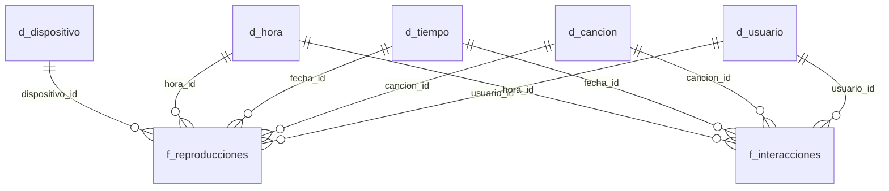

# Homework Lecture 5: modelo dimensional para MusicFlow

Homework del Módulo 2 (SQL) de Henry Data Science. Es un trabajo de **diseño**: a partir de la descripción del sistema transaccional (OLTP) de MusicFlow se propone un modelo dimensional. No incluye datos ni consultas para ejecutar.

## El caso

MusicFlow es una plataforma de streaming musical que opera en varios países de América Latina, con más de 2 millones de usuarios activos. Su base de datos transaccional funciona bien para la operación diaria, pero el Director de Producto y el Head of Marketing no pueden responder con facilidad estas preguntas:

1. ¿Cuáles son los géneros musicales más populares por país y por franja horaria?
2. ¿Qué canciones generan más engagement (likes, shares, agregados a playlist)?
3. ¿Cuál es el patrón de consumo de música de los usuarios premium y freemium?
4. ¿Qué artistas tienen mayor retención de oyentes (usuarios que vuelven a escuchar sus canciones)?

Hoy cada reporte tarda mucho, requiere múltiples uniones complejas y necesita al equipo técnico para interpretar los resultados.

### Datos disponibles en el sistema actual

| Tabla | Columnas |
|---|---|
| `reproducciones` | reproduccion_id, usuario_id, cancion_id, timestamp_inicio, timestamp_fin, dispositivo, calidad_audio, completada |
| `interacciones` | interaccion_id, usuario_id, cancion_id, tipo_interaccion, timestamp |
| `usuarios` | usuario_id, fecha_registro, tipo_suscripcion, pais, edad, genero |
| `canciones` | cancion_id, titulo, artista_id, album_id, duracion_segundos, genero_musical, fecha_lanzamiento, explicit |

## Parte 1: análisis de requisitos

### Métricas clave

| Pregunta | Métrica | Cómo se calcula |
|---|---|---|
| Géneros más populares por país y franja | Cantidad de reproducciones | Contar reproducciones |
| | Minutos escuchados | `timestamp_fin - timestamp_inicio` |
| Canciones con más engagement | Likes, shares y agregados a playlist | Contar interacciones por tipo |
| Patrón premium vs. freemium | Reproducciones por usuario | Reproducciones / usuarios |
| | Tasa de canciones completadas | Completadas / total de reproducciones |
| | Tasa de skips | Skips / total de reproducciones |
| Artistas con mayor retención | Oyentes que vuelven | Usuarios que escuchan al mismo artista en más de un período |

La retención no se guarda como dato: **se calcula** a partir de las reproducciones de cada usuario en distintos períodos.

### Atributos descriptivos

| Sobre qué | Atributos |
|---|---|
| Usuario | Tipo de suscripción, país, rango de edad, género, fecha de registro |
| Canción | Título, género musical, duración, fecha de lanzamiento, explícito |
| Artista y álbum | Identificadores (el sistema no tiene más datos) |
| Tiempo | Fecha, día de la semana, mes, año, hora, franja horaria |
| Reproducción | Dispositivo, calidad de audio |
| Interacción | Tipo de interacción |

### Clasificación y justificación

| Elemento | Clasificación | Justificación |
|---|---|---|
| Cantidad de reproducciones | Hecho | Es un valor que se cuenta y se suma |
| Segundos escuchados | Hecho | Es un número que se suma y se promedia |
| Completada | Hecho | Aunque es booleano, no describe sino que se mide: sumado como 1 o 0 da la tasa de canciones completadas |
| Cantidad de interacciones | Hecho | Se cuenta por tipo |
| Usuario y sus atributos | Dimensión | Describe quién escucha |
| Canción, artista y álbum | Dimensión | Describe qué se escucha |
| Fecha, hora y franja horaria | Dimensión | Describe cuándo y permite agrupar por período |
| Dispositivo y calidad de audio | Dimensión | Describe cómo se escuchó |
| Tipo de interacción | Dimensión | Describe qué acción se realizó |

Dos decisiones sobre los atributos:

- **La edad se guarda como rango** ("18-24", "25-34"…). La edad exacta cambia todos los años y para el análisis se usa agrupada.
- **La franja horaria se deriva de la hora** del evento, para poder agrupar sin calcularla en cada consulta.

## Parte 2: diseño del modelo dimensional

### Dos tablas de hechos con dimensiones compartidas

Una reproducción y una interacción son eventos de distinto tipo. La reproducción tiene duración, dispositivo, calidad y puede completarse o no; la interacción solo tiene un tipo. Si se guardaran en una misma tabla, la mitad de las columnas quedarían vacías en cada fila.

Por eso, aunque la consigna menciona "la tabla de hechos central", el diseño propone **dos tablas de hechos que comparten dimensiones**. Este tipo de modelo se conoce como **constelación de hechos**: dos esquemas estrella unidos por sus dimensiones comunes.

### Tablas de hechos

**`f_reproducciones`**: una fila por reproducción.

| Columna | Rol |
|---|---|
| reproduccion_id | Clave primaria |
| fecha_id | Clave foránea a `d_tiempo` |
| hora_id | Clave foránea a `d_hora` |
| usuario_id | Clave foránea a `d_usuario` |
| cancion_id | Clave foránea a `d_cancion` |
| dispositivo_id | Clave foránea a `d_dispositivo` |
| tipo_suscripcion | Suscripción del usuario en el momento de la reproducción |
| segundos_escuchados | Medida: `timestamp_fin - timestamp_inicio` |
| completada | Medida: 1 si se escuchó completa, 0 si no |

**`f_interacciones`**: una fila por interacción.

| Columna | Rol |
|---|---|
| interaccion_id | Clave primaria |
| fecha_id | Clave foránea a `d_tiempo` |
| hora_id | Clave foránea a `d_hora` |
| usuario_id | Clave foránea a `d_usuario` |
| cancion_id | Clave foránea a `d_cancion` |
| tipo_interaccion | like, dislike, share, add_to_playlist o skip |
| tipo_suscripcion | Suscripción del usuario en el momento de la interacción |
| cantidad | Medida: siempre 1, se suma para contar |

**Por qué `tipo_suscripcion` está en los hechos y no en `d_usuario`:** un usuario puede pasar de freemium a premium. Si la suscripción estuviera solo en la dimensión, se guardaría el valor actual, y las reproducciones de cuando el usuario era freemium aparecerían como premium. Guardándola en cada evento, la comparación entre premium y freemium respeta lo que pasó en cada momento.

### Tablas de dimensiones

| Tabla | Clave primaria | Atributos |
|---|---|---|
| `d_usuario` | usuario_id | pais, rango_edad, genero, fecha_registro |
| `d_cancion` | cancion_id | titulo, genero_musical, duracion_segundos, fecha_lanzamiento, explicit, artista_id, album_id |
| `d_tiempo` | fecha_id | fecha, dia, dia_semana, mes, anio |
| `d_hora` | hora_id (0 a 23) | franja_horaria (madrugada, mañana, tarde, noche) |
| `d_dispositivo` | dispositivo_id | dispositivo, calidad_audio |

### Diagrama conceptual



Versión textual:

```
                 d_tiempo     d_hora     d_dispositivo
                     \          |          /
                      \         |         /
      d_usuario ────── f_reproducciones ────── d_cancion
          \                                       /
           \                                     /
            ──────────  f_interacciones  ────────
                          /          \
                     d_tiempo       d_hora
```

`d_usuario`, `d_cancion`, `d_tiempo` y `d_hora` son compartidas por las dos tablas de hechos; `d_dispositivo` solo se relaciona con las reproducciones.

## Parte 3: evaluación de alternativas

### Dimensiones que podrían normalizarse en un copo de nieve

| Dimensión | Normalización posible |
|---|---|
| `d_cancion` | Separar `d_album` y `d_artista`: cada canción apunta a su álbum y cada álbum a su artista |
| `d_cancion` | Separar `d_genero_musical` |
| `d_usuario` | Separar `d_pais`, con datos como región o moneda |
| `d_tiempo` | Separar la jerarquía mes y año |

La más natural es la de artista y álbum, porque responde a una jerarquía real: una canción pertenece a un álbum y un álbum a un artista.

### Ventajas y desventajas para MusicFlow

| Aspecto | Estrella | Copo de nieve |
|---|---|---|
| Consultas | Simples: una unión por dimensión | Más uniones: canción, álbum, artista |
| Velocidad | Mayor, por tener menos uniones | Menor en consultas sobre grandes volúmenes |
| Usuarios no técnicos | Fácil de entender: todo lo de la canción está en un solo lugar | Hay que saber qué tabla se une con cuál |
| Espacio | Repite datos en las dimensiones | Ahorra espacio |
| Mantenimiento | Un cambio en el artista se actualiza en todas sus canciones | Un cambio se actualiza en un solo lugar |

### Recomendación: esquema estrella

1. **El problema a resolver es la lentitud y la dependencia del equipo técnico.** El copo de nieve agrega uniones, que es justamente lo que hoy hace lentos los reportes.
2. **El ahorro de espacio es mínimo.** El volumen está en los hechos (millones de reproducciones de más de 2 millones de usuarios), no en las dimensiones.
3. **De artista y álbum solo existen identificadores.** Separarlos crearía tablas sin datos descriptivos. Si en el futuro se incorporan datos como el nombre del artista o la discográfica, conviene reevaluar la normalización.

La pregunta de retención por artista se responde igual con el esquema estrella, porque `artista_id` forma parte de `d_cancion`.

## Parte 4: preguntas finales

### 1. ¿Por qué el modelo dimensional es más eficiente que el OLTP para generar reportes?

Porque cada modelo está pensado para una tarea distinta. El OLTP está normalizado para **registrar** muchas operaciones pequeñas sin duplicar datos; por eso, para un reporte hay que unir muchas tablas y reconstruir la información. El modelo dimensional está pensado para **leer y agregar**: los hechos están en una tabla y el contexto en dimensiones directas, de modo que cada pregunta se resuelve con pocas uniones y un `GROUP BY`. Además, los datos que en el OLTP habría que calcular en cada consulta, como la duración escuchada o la franja horaria, ya se calculan durante la carga del modelo.

### 2. ¿Qué beneficios específicos obtendría el equipo de negocio?

- **Respuesta directa a las cuatro preguntas:** géneros por país y franja (`f_reproducciones` con `d_cancion`, `d_usuario` y `d_hora`), engagement por canción (`f_interacciones` con `d_cancion`), premium vs. freemium (`tipo_suscripcion` en los hechos) y retención por artista (`artista_id` en `d_cancion`).
- **Comparaciones fieles en el tiempo:** al guardar la suscripción en cada evento, el cambio de plan de un usuario no altera su historial.
- **Escuchas e interacciones en un mismo reporte,** gracias a las dimensiones compartidas.
- **Reportes más rápidos,** sin depender del equipo técnico.

### 3. ¿Cómo facilita el diseño la autogestión de reportes por parte de usuarios no técnicos?

El modelo usa el lenguaje del negocio: las tablas se llaman como lo que el equipo ya conoce (usuario, canción, tiempo), los atributos vienen listos para agrupar (rango de edad, franja horaria) y las métricas están concentradas en las tablas de hechos. Conectado a una herramienta como Power BI, un usuario puede armar un reporte arrastrando campos como "género musical" y "país", sin escribir SQL ni conocer la estructura del sistema transaccional.
