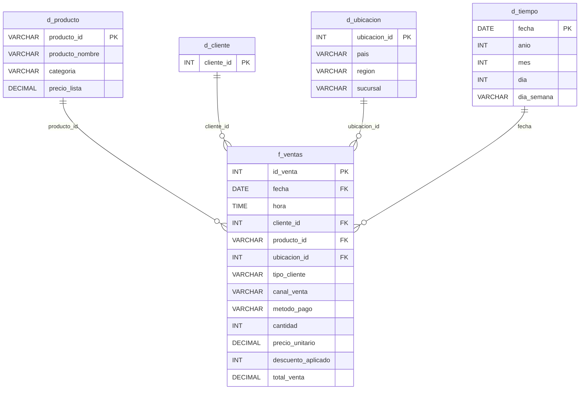

# Lecture 5: modelado dimensional (caso RetailX)

Práctica del Módulo 2 (SQL) de Henry Data Science, en **PostgreSQL** con DBeaver. A partir de un dataset plano de ventas se construye un **modelo estrella** y se responden las preguntas de un stakeholder (el CFO de RetailX).

## Contenido

| Archivo | Qué es |
|---|---|
| `M2_L5_retailx_laroga.sql` | Script completo: staging, revisión de datos, modelo estrella, carga (ETL) y consultas de negocio |
| `data/dataset_retailx.csv` | Dataset de la clase: 50 ventas de julio de 2025 en una sola tabla |
| `M2_L5_homework_musicflow_laroga/README.md` | Homework: diseño de un modelo dimensional para MusicFlow, una plataforma de streaming musical (trabajo de diseño, sin datos) |

## El pedido del stakeholder

> "Quiero saber qué productos son más rentables por región y entender cómo varían las ventas según la franja horaria. Además, nos gustaría explorar el comportamiento de los clientes más frecuentes."

| Necesidad | Métrica | Dimensiones |
|---|---|---|
| Rentabilidad por región | Venta neta y descuento resignado | Ubicación, producto |
| Ventas por franja horaria | Ventas, unidades, ticket promedio | Hora |
| Nuevos vs. recurrentes | Ticket promedio | Tipo de cliente, canal |

## Modelo

## Cómo ejecutarlo

1. Crear la base `retailx` y abrir un editor conectado a ella (en DBeaver: clic derecho sobre la base → *SQL Editor → New SQL script*).
2. Ejecutar el paso 1 del script, que crea la tabla `stg_ventas`.
3. Importar `data/dataset_retailx.csv` en `stg_ventas` con *Import Data* de DBeaver. En *Tables mapping*, las columnas `categoría`, `región` y `método_pago` del CSV hay que asignarlas a mano a `categoria`, `region` y `metodo_pago`; si no, DBeaver crea columnas nuevas con tilde.
4. Ejecutar el resto del script en orden. Los pasos 4 y 5 empiezan con `DROP` y `TRUNCATE`, así que se pueden volver a correr.

**Verificación de la carga:** d_producto 6, d_cliente 48, d_ubicacion 35, d_tiempo 7, f_ventas 50. La venta total es 1.027.600 tanto en el staging como en el modelo.

## Decisiones tomadas a partir de los datos

La revisión del dataset (paso 3 del script) mostró que el modelo de ejemplo de la clase no se podía aplicar tal cual:

- **El tipo de cliente no es un dato fijo del cliente.** Los clientes 151 y 954 aparecen como *nuevo* y como *recurrente*, en países distintos; el 954 figura como recurrente el 6 de julio y como nuevo el 7. Por eso `tipo_cliente` va en `f_ventas` (el tipo en el momento de cada compra) y no en `d_cliente`. Lo mismo pasa con el país, que se toma de la ubicación de la venta.
- **La sucursal sola no identifica un lugar.** "Sucursal 1" aparece en los cuatro países y en las cuatro regiones. Se creó `d_ubicacion`, con una clave sustituta para cada combinación de país, región y sucursal (35 en total).
- **"Región" no alcanza para comparar.** "Norte" existe en los cuatro países, así que agrupar solo por región mezclaría lugares distintos. Las consultas por región se hacen por país.
- **Staging antes del modelo.** El CSV se carga primero en una tabla sin restricciones y recién después se distribuye en dimensiones y hechos. Las columnas se renombraron sin tilde para no tener que usar comillas en PostgreSQL.

## Limitación del dataset

El CFO pide **rentabilidad y margen**, pero el dataset **no trae costo**. Sin costo no se puede calcular margen. Las consultas usan la **venta neta** y el **descuento resignado** (precio de lista × cantidad − venta neta) como aproximación. Para medir rentabilidad real habría que pedir el costo de cada producto y sumarlo a `d_producto`.

## Resultados

**Venta neta por país y categoría:** Electrónica lidera en Argentina (217.800) y Hogar en Chile y Colombia. Chile resigna 16.200 en descuentos de Electrodomésticos, el valor más alto de ese país.

**Franjas horarias:**

| Franja | Ventas | Venta neta | Ticket promedio |
|---|---|---|---|
| Mañana (8-11) | 19 | 360.700 | 18.984,21 |
| Mediodía (12-14) | 12 | 316.200 | 26.350,00 |
| Tarde (15-17) | 9 | 145.900 | 16.211,11 |
| Noche (18-20) | 10 | 204.800 | 20.480,00 |

La mañana concentra más ventas, pero el mediodía tiene el ticket más alto.

**Nuevos vs. recurrentes:** los clientes nuevos llegan casi todos por el canal online (16 de 19 ventas) y gastan más por compra (ticket promedio de 23.268 contra 18.887 de los recurrentes).

## Alcance

Con 50 ventas de una sola semana, este trabajo es un **ejercicio para aplicar la teoría del modelado dimensional**, no un análisis con conclusiones firmes. El método es el de un análisis real (relevar requisitos, revisar los datos, modelar, validar y consultar), pero el tamaño de la muestra no permite afirmar tendencias. Por eso lo que sigue se presenta como **situaciones a investigar** con un volumen de datos mayor.

## Situaciones a investigar

### Fallas y faltantes en los datos

- **Moneda sin especificar.** Hay ventas en cuatro países y los montos se suman entre sí. Los precios son idénticos en todos los países (la Notebook Pro vale 15.000 en los cuatro), lo que sugiere una moneda única, pero el dataset no lo indica. Si cada país registrara en su moneda local, los totales sumados no tendrían sentido. Es lo primero que habría que confirmar.
- **No se puede medir la frecuencia de compra.** El CFO pidió analizar a los clientes más frecuentes, pero en 50 ventas hay 48 clientes distintos y solo 2 repiten. Además, 31 ventas figuran como *recurrentes*: esa marca proviene de un historial que no está en el dataset y no se puede verificar.
- **El identificador de cliente podría no ser único entre países.** Los dos clientes que repiten lo hacen en países distintos. Además de un error de carga, es posible que cada país numere sus clientes por separado, como ocurre con las sucursales.
- **Días con pocas ventas.** El viernes 4 de julio tiene 2 ventas y el domingo 6 tiene 3, contra 7 a 11 el resto de los días. Puede ser un comportamiento real o datos faltantes.
- **Ventas online pagadas en efectivo.** Son 14 de las 30 ventas online. Puede tratarse de pago contra entrega o de un error de carga.
- **Datos que faltan para el negocio:** costo de los productos, devoluciones y cancelaciones, y moneda.

### Insights

- **Se resigna el 10,7% de la venta en descuentos** (122.900 sobre 1.150.500 a precio de lista). El descuento más frecuente es el máximo: 17 de las 50 ventas tienen un 20%.
- **Los descuentos no muestran una política clara.** Clientes nuevos y recurrentes reciben en promedio casi lo mismo (10,5% y 11,8%), igual que los canales online y presencial (11% y 11,8%).
- **México es el país con menos ventas y más descuento:** 9 ventas, la menor facturación (142.850) y un 14,7% de descuento sobre el precio de lista, contra cerca del 10% en los demás países.
- **Tres categorías concentran el negocio.** Electrónica, Electrodomésticos y Hogar suman el 97% de la venta neta. Indumentaria aporta el 3%, con 4 ventas.
- **Los clientes nuevos gastan más por compra que los recurrentes** (ticket promedio de 23.268 contra 18.887) y llegan casi todos por el canal online.
- **La mañana concentra más ventas, pero el mediodía tiene el ticket más alto.**

### Recomendaciones

- **Completar los datos antes de decidir:** confirmar la moneda, incorporar el costo por producto para medir margen y ampliar el período a varios meses.
- **Revisar la política de descuentos.** Si el 20% es el descuento más común y no distingue tipo de cliente ni canal, es probable que se esté resignando margen sin un objetivo. Conviene definir reglas, por ejemplo, reservar los descuentos mayores para clientes recurrentes o para productos de baja rotación.
- **Analizar México por separado**, para entender si descuenta más porque vende poco o si vende poco a pesar de descontar.
- **Definir identificadores únicos de cliente y de sucursal a nivel empresa**, para poder medir la frecuencia de compra y no depender de combinaciones como país, región y sucursal.
- **Trabajar la retención del cliente nuevo**, que compra online y con ticket alto, para convertirlo en recurrente.
- **Validar en el origen** las ventas online pagadas en efectivo y los días con pocas ventas.

## Sobre los scripts de ejemplo de la clase

Los scripts `RetailX_*.sql` de la clase ilustran la teoría (OLTP vs. dimensional, consultas sobre estrella, variante copo de nieve), pero usan tablas que no existen en el dataset y asumen diseños distintos entre sí. Las consultas del paso 6 de este trabajo son esas mismas ideas, adaptadas al modelo construido con los datos reales.

