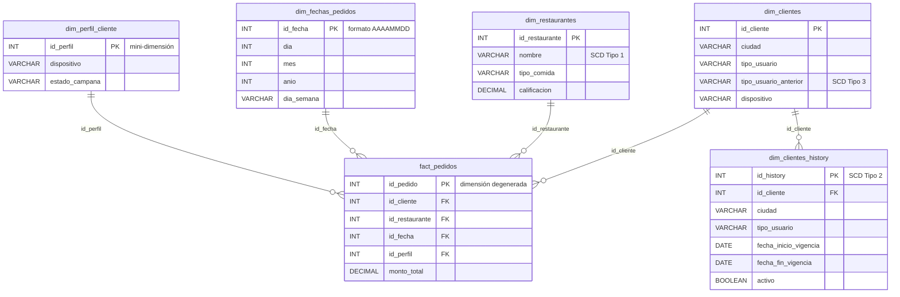

# Lecture 6: modelado dimensional avanzado (plataforma de delivery)

Práctica del Módulo 2 (SQL) de Henry Data Science, en **PostgreSQL** con DBeaver. Sobre un modelo estrella de pedidos de una plataforma de delivery se trabajan los tipos de tablas de hechos, las métricas aditivas y derivadas, las dimensiones lentamente cambiantes (SCD), las técnicas avanzadas de modelado y la optimización.

## Contenido

| Archivo | Qué es |
|---|---|
| `M2_L6_delivery_laroga.sql` | Script completo: carga, claves, consultas y cada técnica de la lecture, en orden |
| `data/fact_pedidos.csv` | 10 pedidos del 1 al 5 de julio de 2023 |
| `data/dim_clientes.csv` | 7 clientes |
| `data/dim_restaurantes.csv` | 4 restaurantes |
| `data/dim_fechas_pedidos.csv` | 5 fechas |

## Modelo

## Cómo ejecutarlo

1. Crear la base `delivery` y abrir un editor conectado a ella (en DBeaver: clic derecho sobre la base → *SQL Editor → New SQL script*). Verificar que la barra diga `public@delivery`.
2. Ejecutar el paso 1, que crea las cuatro tablas vacías.
3. Importar cada CSV de `data/` en su tabla con *Import Data*. En `dim_fechas_pedidos`, la columna `año` del CSV hay que asignarla a mano a `anio`.
4. Ejecutar el resto del script **en orden y por bloques**.

**Verificación de la carga:** dim_clientes 7, dim_restaurantes 4, dim_fechas_pedidos 5, fact_pedidos 10. Monto total: **17.600**.

**Ojo con el orden:** el paso 6c modifica `dim_clientes` (el cliente 301 pasa a Córdoba). Para repetir el trabajo desde cero hay que volver a importar `dim_clientes.csv`.

## Lo que se trabajó

### Tipos de tablas de hechos

| Tipo | Cada fila es… | En este trabajo |
|---|---|---|
| Transaccional | Un evento | `fact_pedidos`: un pedido |
| Snapshot periódico | El estado de algo en una fecha | `snapshot_restaurantes` |
| Snapshot acumulativo | Un proceso que se actualiza a medida que avanza (pedido creado, preparado, entregado) | No hay datos para construirlo |
| Agregada | Un resumen de transacciones | `fact_pedidos_diarios`: pedidos por restaurante y día |

### Métricas

| Tipo | Ejemplo |
|---|---|
| Aditiva | `monto_total`: total por cliente, por ciudad y por día de la semana; en los tres casos suma 17.600 |
| Semi-aditiva | Un saldo de crédito promocional: se suma entre clientes, pero no a lo largo del tiempo |
| No aditiva (derivada) | Ticket promedio, monto promedio por tipo de comida, porcentaje de pedidos recurrentes (60%) |

### SCD: qué tipo corresponde a cada atributo

| Atributo | Tipo | Por qué |
|---|---|---|
| `ciudad` del cliente | Tipo 2 | Para analizar a los clientes que se mudan, cada pedido tiene que conservar la ciudad de ese momento |
| `tipo_usuario` | Tipo 2 (y Tipo 3 como ejemplo) | Para ver cómo evoluciona el porcentaje de recurrentes |
| `dispositivo` | Mini-dimensión | Cambia seguido; con Tipo 2 cada cambio crearía una versión nueva del cliente |
| `nombre` del restaurante | Tipo 1 | Un cambio de nombre no necesita historial |

**El impacto del Tipo 2:** cruzando los pedidos con la versión del cliente vigente en cada fecha, Buenos Aires suma **7.300**. Con el estado actual sumaría **1.700**, porque los 5.600 que el cliente 301 gastó mientras vivía en Buenos Aires pasarían a contarse en Córdoba.

### Técnicas avanzadas

- **Mini-dimensión** `dim_perfil_cliente`: guarda las combinaciones de dispositivo y estado de campaña, y cada pedido apunta al perfil que tenía en ese momento.
- **Dimensión degenerada:** `id_pedido`, que vive en la tabla de hechos sin tabla propia y sirve para rastrear un pedido.
- **Dimensión de rol** (conceptual): si existiera fecha de entrega, `dim_fechas_pedidos` se usaría dos veces, como fecha de pedido y como fecha de entrega.
- **Dimensión junk** (conceptual): agruparía banderas sueltas como `pago_con_cupon` o `envio_gratis` en una tabla de combinaciones.

### Optimización

- **Índices** en las claves foráneas de la tabla de hechos y en los atributos de corte frecuentes.
- **Particionamiento por rango de fecha**, con una partición para 2023 y una por defecto. El plan de ejecución confirma que, al filtrar por julio de 2023, solo se lee la partición de 2023.
- **Vista materializada** `top_restaurantes`, con un índice único que permite refrescarla con `CONCURRENTLY`.

## Ajustes realizados al ejecutar los scripts

Al ejecutar los scripts de referencia con los datos del dataset, se hicieron estos ajustes:

- **Restricciones:** PostgreSQL no admite `ADD CONSTRAINT IF NOT EXISTS`. Para que el script se pueda volver a ejecutar, cada restricción se elimina con `DROP CONSTRAINT IF EXISTS` antes de crearla.
- **Mini-dimensión:** se enlaza desde la tabla de hechos, de modo que cada pedido conserve el perfil vigente en su fecha. Guarda combinaciones de valores (no una fila por cliente) y usa solo los dispositivos presentes en el dataset.
- **SCD Tipo 2:** se incluye la carga inicial del historial, con una fecha de inicio anterior al primer pedido (1/1/2023), y los cambios se fechan en 2023, para que cada pedido encuentre la versión del cliente vigente en su fecha.
- **Particionamiento:** como el límite superior de un rango no se incluye, la partición de 2023 se define hasta el `2024-01-01`, de modo que abarque el 31 de diciembre. Se agrega además una partición por defecto.
- **Tipos de tablas de hechos:** el resumen diario de pedidos se trata como tabla agregada, y el total corrido por cliente como un cálculo con función de ventana. Los términos *snapshot* y *hecho acumulativo* se reservan para el estado de algo en una fecha y para un proceso que se actualiza por etapas.
- **Ingreso por día de la semana:** se agrupa por `dia_semana`, el nombre del día.
- **Snapshot de restaurantes:** se guarda en una sola tabla con una columna `fecha_snapshot`, que permite acumular fechas y compararlas. La calificación se toma tal como figura en la dimensión.
- **Índices:** se crea un solo índice por columna, para no duplicar el de `id_cliente`.
- **Nombres:** la columna `año` se renombra como `anio`, para evitar la ñ en PostgreSQL.

## Alcance

Con 10 pedidos de 5 días, es un **ejercicio para practicar las técnicas**, no un análisis. Varias preguntas de la consigna no se pueden responder con estos datos:

- Los cambios de los clientes son de septiembre y los pedidos de julio: **no hay pedidos posteriores a la mudanza** para comparar el comportamiento antes y después.
- No hay datos de enero ni de abril para **comparar dispositivos**, ni un período suficiente para ver la **evolución** de los recurrentes.
- No hay datos de **campañas**: en la mini-dimensión figuran como "Sin dato".

El modelo queda preparado para responderlas cuando haya más datos. Por la misma razón, la tabla agregada y el particionamiento no mejoran el rendimiento con 10 filas: son técnicas pensadas para millones de registros.
