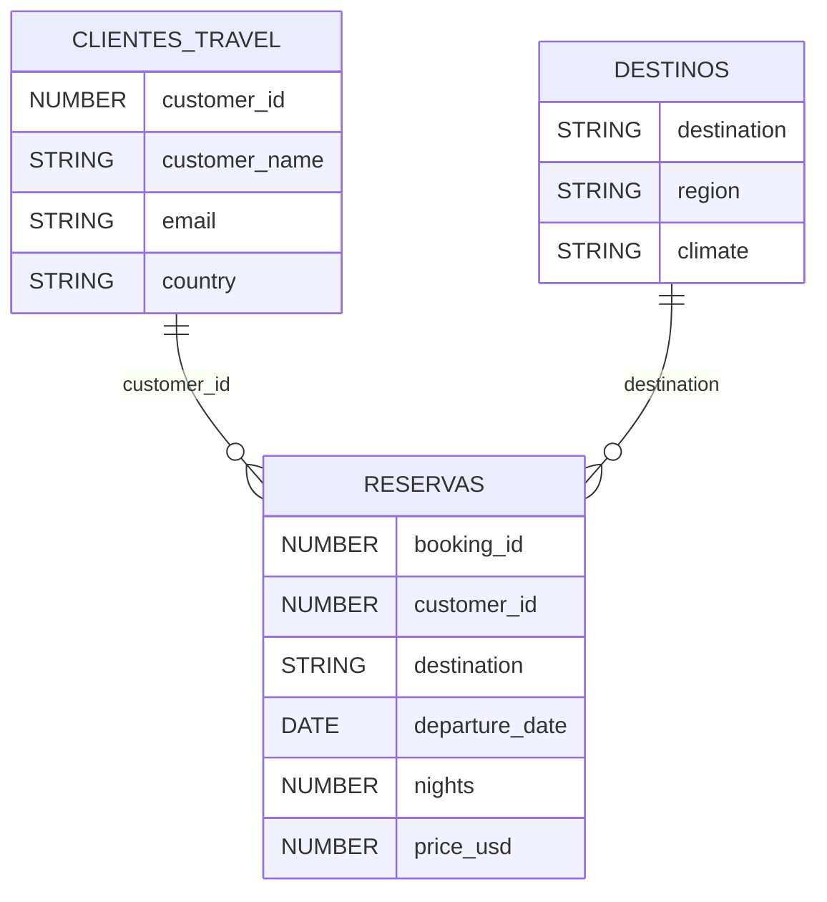

# Homework Lecture 7: data warehouse de TravelNow en Snowflake

Homework del Módulo 2 (SQL) de Henry Data Science, en **Snowflake**. TravelNow es una agencia de viajes que necesita centralizar sus reservas, sus clientes y su catálogo de destinos en un data warehouse en la nube. Como extra, se crea una vista con el total gastado por destino y se consulta desde **Python**.

## Contenido

| Archivo | Qué es |
|---|---|
| `M2_L7_homework_travelnow_laroga.sql` | Script completo: warehouse, base, stages, tablas, carga, consulta de validación y vista |
| `data/clientes_travel.csv` | 3 clientes con su país |
| `data/destinos.csv` | 4 destinos con región y clima |
| `data/reservas.csv` | 4 reservas, con noches y precio en dólares |
| `python/consulta_travelnow.py` | Extra: consulta la vista desde Python |
| `python/requirements.txt` | Librería que necesita el script |
| `capturas/` | Capturas de cada paso (ver abajo) |

## Modelo



Todo vive en la base `TRAVELNOW_DWH`, esquema `RESERVAS`, y se procesa con el warehouse `WH_TRAVELNOW` (XSMALL, se apaga a los 5 minutos sin uso y se enciende solo).

## Cómo ejecutarlo

1. En Snowsight, crear un worksheet y ejecutar el paso 1, que crea el warehouse, la base, el esquema, el formato de archivo y los stages.
2. Subir cada CSV de `data/` a su stage, desde la página de cada stage en *Catalog* (`TRAVELNOW_DWH → RESERVAS → Stages`): `clientes_travel.csv` a `STG_CLIENTES_TRAVEL`, `destinos.csv` a `STG_DESTINOS` y `reservas.csv` a `STG_RESERVAS`.
3. Ejecutar el resto del script por bloques, con Cmd+Enter. La línea `REMOVE` del paso 2 corrige un archivo subido al stage equivocado y solo hace falta si ocurrió lo mismo.
4. Al terminar, ejecutar el script de limpieza de la lecture: `../M2_L7_limpieza_snowflake_laroga.sql`.

**Verificación de la carga:** CLIENTES_TRAVEL 3, DESTINOS 4, RESERVAS 4.

## Resultados

**Consulta de validación: total de reservas por país de origen del cliente**

| País | Reservas | Noches | Total USD |
|---|---|---|---|
| Argentina | 2 | 15 | 2.950 |
| Chile | 1 | 7 | 1.400 |
| Uruguay | 1 | 3 | 620 |

El total, 4.970 USD, coincide con la suma de `price_usd` del archivo de reservas.

**Vista `VW_TOTAL_POR_DESTINO`: total gastado por destino**

| Destino | Región | Clima | Reservas | Noches | Total USD |
|---|---|---|---|---|---|
| Tokio | Asia | Húmedo | 1 | 10 | 2.100 |
| Nueva York | América del Norte | Frío | 1 | 7 | 1.400 |
| Barcelona | Europa | Templado | 1 | 5 | 850 |
| París | Europa | Templado | 1 | 3 | 620 |

La vista parte de `DESTINOS` con `LEFT JOIN`, de modo que un destino sin reservas también aparecería en la lista.

## Extra: consulta desde Python

`python/consulta_travelnow.py` se conecta a Snowflake con `snowflake-connector-python`, consulta la vista e imprime el resultado. La salida coincide con la de Snowsight.

### Autenticación por par de claves

El script se autentica con un **par de claves RSA**, sin contraseña:

- La **clave privada** (`rsa_key.p8`) queda en la computadora y no se publica: está en `.gitignore`.
- La **clave pública** se registra en el usuario de Snowflake con `ALTER USER ... SET RSA_PUBLIC_KEY`.
- La cuenta y el usuario se leen de variables de entorno, para que no queden escritos en el código.

Antes de elegir este método se probaron otros dos, que no se podían usar con esta cuenta:

| Método | Por qué no se pudo usar |
|---|---|
| Inicio de sesión en el navegador (`externalbrowser`) | Requiere que la cuenta tenga configurado un proveedor de identidad (SSO por SAML). Devuelve el error 390190 |
| Contraseña | La cuenta se creó con el inicio de sesión de Google y no tiene contraseña. Agregarle una obliga a configurar MFA en las cuentas nuevas |

### Cómo ejecutarlo

Desde la carpeta `python`, en la Terminal:

```bash
# 1. Entorno virtual e instalación
python3 -m venv .venv
source .venv/bin/activate
pip install -r requirements.txt

# 2. Par de claves
openssl genrsa 2048 | openssl pkcs8 -topk8 -inform PEM -out rsa_key.p8 -nocrypt
openssl rsa -in rsa_key.p8 -pubout -out rsa_key.pub

# 3. Copiar la clave pública en una sola línea, sin los encabezados
grep -v "PUBLIC KEY" rsa_key.pub | tr -d '\n' | pbcopy
```

En Snowsight, con el rol `ACCOUNTADMIN`, registrar la clave pegándola en lugar de `CLAVE_PUBLICA`:

```sql
SELECT CURRENT_USER();
ALTER USER "nombre_devuelto" SET RSA_PUBLIC_KEY = 'CLAVE_PUBLICA';
DESC USER "nombre_devuelto";   -- HAS_KEYPAIR tiene que decir true
```

Por último, ejecutar el script:

```bash
export SNOWFLAKE_ACCOUNT='organizacion-cuenta'
export SNOWFLAKE_USER='nombre_de_inicio_de_sesion'
python consulta_travelnow.py
```

## Capturas

| Captura | Qué muestra |
|---|---|
| [`travelnow_creacion.png`](capturas/travelnow_creacion.png) | Los tres stages creados |
| [`travelnow_verificacion_tablas.png`](capturas/travelnow_verificacion_tablas.png) | Conteo de filas después de la carga: 3, 4 y 4 |
| [`travelnow_validacion.png`](capturas/travelnow_validacion.png) | Consulta de validación por país de origen |
| [`travelnow_total_destino.png`](capturas/travelnow_total_destino.png) | La vista `VW_TOTAL_POR_DESTINO` en Snowsight |
| [`travelnow_python_consulta_vista.png`](capturas/travelnow_python_consulta_vista.png) | La misma vista consultada desde Python |

## Ajustes realizados al ejecutar los scripts

- **Relación por nombre de destino:** las reservas no traen un identificador de destino, sino su nombre. La vista une `RESERVAS` y `DESTINOS` por la columna `DESTINATION`, así que los nombres tienen que escribirse igual en los dos archivos.
- **Archivo en el stage equivocado:** `reservas.csv` se subió también al stage de destinos. Se eliminó con `REMOVE` y se subió `destinos.csv`. La corrección queda en el script con su comentario.
- **Stages, carga y orden de columnas:** se aplicaron los mismos ajustes que en RetailX (ver el [README de la lecture](../README.md)): `CREATE STAGE IF NOT EXISTS`, `COPY INTO` con `FORCE = TRUE` y columnas en el orden del CSV.
- **Nombre de usuario en Python:** Snowflake distingue entre el nombre del usuario (`NAME`) y el nombre con que inicia sesión (`LOGIN_NAME`). En una cuenta creada con Google, el nombre de inicio de sesión es el email, y es el que se usa en `SNOWFLAKE_USER`. Como el nombre del usuario está en minúsculas, en `ALTER USER` va entre comillas dobles: sin comillas, Snowflake lo pasa a mayúsculas y no lo encuentra.
- **Aviso al conectar:** la versión 5 del conector muestra un `FutureWarning` si no se indica `enable_server_session_keep_alive_auto_detection`. Se define en `False` para que la salida quede limpia.

## Alcance

Con 4 reservas de 3 clientes, el trabajo es un **ejercicio para practicar la plataforma**, no un análisis. Cada destino tiene una sola reserva, así que el ranking por destino refleja el precio de cada viaje y no la preferencia de los clientes.
