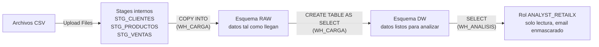

# Lecture 7: data warehousing en Snowflake (caso RetailX)

Práctica del Módulo 2 (SQL) de Henry Data Science, en **Snowflake**, desde la interfaz web (Snowsight). Se arma un data warehouse completo en la nube: warehouses de cómputo, base de datos con capas RAW y DW, carga de archivos CSV desde stages internos, enmascaramiento de datos sensibles, un rol de analista con permisos de solo lectura y consultas de análisis.

## Contenido

| Archivo | Qué es |
|---|---|
| `M2_L7_retailx_laroga.sql` | Trabajo integrador de la lecture: RetailX, del warehouse a las consultas de análisis |
| `M2_L7_limpieza_snowflake_laroga.sql` | Elimina todo lo creado en los dos trabajos de la lecture |
| `data/clientes.csv` | 3 clientes con email y región |
| `data/productos.csv` | 3 productos con categoría |
| `data/ventas.csv` | 4 ventas de julio de 2023 |
| `capturas/` | Capturas de cada paso en Snowsight (ver abajo) |
| [`M2_L7_homework_travelnow_laroga/`](M2_L7_homework_travelnow_laroga) | Homework: data warehouse de TravelNow, con una vista y una consulta desde Python |

## Arquitectura

Todo vive en la base `RETAILX_DWH`. La capa **RAW** guarda los datos tal como llegan de los archivos; la capa **DW** es la que se consulta, y en ventas suma la columna calculada `TOTAL_LINEA` (cantidad × precio unitario).

## Cómo ejecutarlo

1. En Snowsight, crear un worksheet y pegar el script.
2. Ejecutar los pasos 2 a 4, que crean los warehouses, la base, los esquemas, el formato de archivo y los stages.
3. Subir cada CSV de `data/` a su stage: en *Catalog*, abrir `RETAILX_DWH → RAW → Stages`, entrar al stage y subir el archivo desde la computadora.
4. Ejecutar el resto del script **por bloques**, seleccionando cada bloque y presionando Cmd+Enter (Ctrl+Enter en Windows).
5. Al terminar los dos trabajos de la lecture, ejecutar `M2_L7_limpieza_snowflake_laroga.sql`.

**Verificación de la carga:** CLIENTES 3, PRODUCTOS 3, VENTAS 4. Total vendido: **340**.

## Lo que se trabajó

### Warehouses y costo

Un warehouse es la capacidad de cómputo que ejecuta las consultas, separada del almacenamiento. Se crearon dos, uno para la carga y otro para el análisis, de modo que una carga pesada no demore las consultas de los analistas y el consumo de cada tarea se pueda medir por separado.

Los dos se configuraron para gastar lo mínimo en una cuenta de prueba:

| Parámetro | Valor | Para qué |
|---|---|---|
| `WAREHOUSE_SIZE` | `XSMALL` | El tamaño más chico, el que menos créditos consume por hora |
| `AUTO_SUSPEND` | `300` | Se apaga solo a los 5 minutos sin uso |
| `AUTO_RESUME` | `TRUE` | Se enciende solo cuando llega una consulta |
| `INITIALLY_SUSPENDED` | `TRUE` | Se crea apagado y no consume hasta que se lo usa |

### Roles

Cada tarea se hizo con el rol pensado para ella, y no todo con el administrador:

| Rol | Uso en este trabajo |
|---|---|
| `SYSADMIN` | Crear warehouses, bases, tablas y la política de enmascaramiento |
| `SECURITYADMIN` | Crear el rol de analista, el usuario y los permisos |
| `ACCOUNTADMIN` | Solo para comprobar que ve el email completo |

### Enmascaramiento del email

La política `MASK_EMAIL`, aplicada a la columna `EMAIL` de `DW.CLIENTES`, decide qué se muestra según el rol de quien consulta:

| Rol | Ve |
|---|---|
| `ACCOUNTADMIN` o `SECURITYADMIN` | `ana@example.com` |
| Cualquier otro, incluido el analista | `***@example.com` |

El dato no se modifica: se enmascara al leerlo. Las políticas de enmascaramiento requieren la edición Enterprise de Snowflake, que es la que ofrece la cuenta de prueba.

### Rol de analista

`ANALYST_RETAILX` puede usar el warehouse de análisis y leer las tablas del esquema DW, incluidas las que se creen en el futuro (`GRANT SELECT ON FUTURE TABLES`). No tiene acceso a RAW ni permisos de escritura. El usuario de ejemplo `RETAILX_ANALYST` recibe ese rol y debe cambiar la contraseña al ingresar.

## Resultados

**Ventas por región del cliente:**

| Región | Ventas | Unidades | Total |
|---|---|---|---|
| Norte | 2 | 5 | 195 |
| Centro | 1 | 1 | 100 |
| Sur | 1 | 1 | 45 |

**Ventas por categoría de producto:**

| Categoría | Ventas | Unidades | Total |
|---|---|---|---|
| Electrónica | 3 | 4 | 235 |
| Accesorios | 1 | 3 | 105 |

## Capturas

| Captura | Qué muestra |
|---|---|
| [`retailX.png`](capturas/retailX.png) | Creación de los warehouses |
| [`retailX_clientes.png`](capturas/retailX_clientes.png) | Carga de clientes: 3 filas leídas y cargadas |
| [`retailX_productos.png`](capturas/retailX_productos.png) | Carga de productos: 3 filas |
| [`retailX_ventas.png`](capturas/retailX_ventas.png) | Carga de ventas: 4 filas |
| [`retailX_verificacion.png`](capturas/retailX_verificacion.png) | Conteo de filas en RAW |
| [`retailX_verificacion_tablas.png`](capturas/retailX_verificacion_tablas.png) | Detalle del conteo: 3, 3 y 4 |
| [`retailX_total_ventas.png`](capturas/retailX_total_ventas.png) | Capa DW: 4 ventas por un total de 340 |
| [`retailX_enmascarar_email.png`](capturas/retailX_enmascarar_email.png) | Con `SYSADMIN`, el email aparece enmascarado |
| [`retailX_rol_autorizado_ve_email.png`](capturas/retailX_rol_autorizado_ve_email.png) | Con `ACCOUNTADMIN`, el email aparece completo |
| [`retailX_roles_designacion.png`](capturas/retailX_roles_designacion.png) | Los 6 permisos del rol `ANALYST_RETAILX`. La contraseña provisoria se reemplazó por un marcador |
| [`retailX_por_region_por_categoria.png`](capturas/retailX_por_region_por_categoria.png) | Ventas por región |
| [`retailX_por_categoria.png`](capturas/retailX_por_categoria.png) | Ventas por categoría |

## Ajustes realizados al ejecutar los scripts

- **Stages con `IF NOT EXISTS`:** `CREATE OR REPLACE STAGE` recrea el stage vacío y borra los archivos ya subidos. Al volver a ejecutar el script completo, la carga posterior no encontraba archivos. Los stages se crean con `CREATE STAGE IF NOT EXISTS`, que conserva los archivos.
- **`COPY INTO` con `FORCE = TRUE`:** Snowflake guarda un historial de los archivos cargados en cada tabla y no los vuelve a cargar. Como las tablas se recrean vacías con `CREATE OR REPLACE`, sin `FORCE` la segunda ejecución no cargaba ninguna fila.
- **Orden de las columnas:** `COPY INTO` carga por posición, no por nombre, así que las columnas de cada tabla se definen en el mismo orden que los encabezados del CSV.
- **Verificación de la carga:** el conteo de filas se ejecuta después de `COPY INTO`, para que muestre las filas cargadas.
- **Contraseña del usuario de ejemplo:** en la versión publicada se reemplaza por un marcador. El usuario se elimina en el script de limpieza.

## Limpieza

`M2_L7_limpieza_snowflake_laroga.sql` elimina las bases, los warehouses, el rol, el usuario de ejemplo y la clave pública registrada para el homework. Al eliminar una base se eliminan también sus tablas, vistas, stages y archivos subidos, y la política de enmascaramiento. Las consultas del final verifican que no quede nada.

## Alcance

Con 4 ventas, el trabajo es un **ejercicio para practicar la plataforma**: el recorrido es el de un data warehouse real (cómputo, capas, carga, seguridad, permisos y consultas), pero los resultados no permiten sacar conclusiones de negocio.
