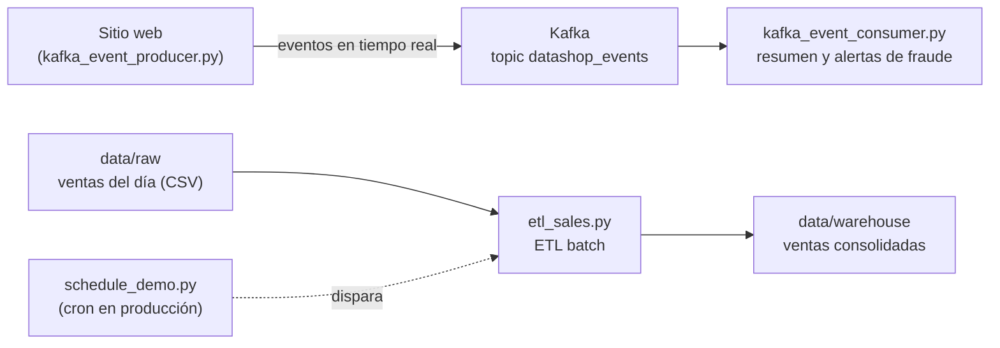

# Lecture 8: fundamentos de arquitectura de datos (caso DataShop)

Práctica del Módulo 2 de Henry Data Science. DataShop es un e-commerce que opera en varios países y necesita una arquitectura de datos para tomar decisiones en tiempo real sin descuidar sus procesos diarios. La práctica arma una maqueta local de esa arquitectura con **Python**, **Kafka** y **Docker**: ingesta de eventos en tiempo real, detección de fraude, consolidación nocturna de ventas y automatización de cargas.

## Contenido

| Archivo | Qué es |
|---|---|
| `etl_sales.py` | ETL batch: consolida las ventas de un día (cantidad de órdenes y total) |
| `schedule_demo.py` | Automatiza el ETL: lo ejecuta cada 10 segundos para la demo |
| `kafka_event_producer.py` | Genera eventos del sitio (vistas, búsquedas, carrito, compras) y los envía a Kafka |
| `kafka_event_consumer.py` | Lee los eventos de Kafka, los resume y marca posibles fraudes (agregado en esta práctica) |
| `docker-compose.yml` | Levanta Kafka con la imagen oficial `apache/kafka` |
| `docker-compose_original_bitnami.yml` | El compose entregado por el curso, que no levanta (ver ajustes) |
| `data/dim/` | Dimensiones: 5 clientes y 5 productos |
| `data/raw/` | Capa cruda: ventas del 28 y 29/08/2025 y eventos de clics de ejemplo |
| `data/warehouse/` | Capa procesada: ventas consolidadas por día, generadas por el ETL |
| `README.txt` | Descripción original del paquete del curso |
| `capturas/` | Capturas de cada ejecución |

## Arquitectura



| Componente del caso | Herramienta de la maqueta | En este trabajo |
|---|---|---|
| Ingesta | Apache Kafka | `kafka_event_producer.py` envía los eventos al topic `datashop_events` |
| Procesamiento en tiempo real | Spark Streaming | `kafka_event_consumer.py` lee el topic, cuenta eventos por tipo, suma compras y detecta fraude |
| Procesamiento batch nocturno | Apache Spark | `etl_sales.py` consolida las ventas de cada día |
| Almacenamiento | Hadoop (HDFS) | Carpetas locales: `data/raw` como capa cruda y `data/warehouse` como capa procesada |
| Automatización | Python `schedule` / `cron` | `schedule_demo.py` |

El procesamiento y el almacenamiento se resuelven con Python y carpetas locales: con 6 ventas y unos pocos eventos, Spark y HDFS no agregan nada a la demo. La lógica es la misma que tendrían en una arquitectura real; lo que cambia es la escala.

### Lambda o Kappa

La maqueta combina las dos rutas de una **arquitectura Lambda**: una rápida (Kafka y el consumidor, para alertar en segundos) y una batch (el ETL nocturno, que produce el cierre exacto del día). En la tabla de decisiones de la lecture, Lambda es la que resuelve el cierre contable exacto, a costa de mantener dos rutas.

El consumidor muestra además la idea central de **Kappa**: lee el topic desde el primer evento, así que Kafka funciona como historial y los eventos se pueden volver a procesar si cambia la regla de fraude.

## Cómo ejecutarlo

Desde la carpeta de la lecture, en la terminal:

```bash
# Entorno y librerías
python3 -m venv .venv
source .venv/bin/activate
pip install schedule kafka-python

# 1. ETL batch, un día por vez (los datos son de agosto de 2025)
python etl_sales.py 2025-08-28
python etl_sales.py 2025-08-29

# 2. Automatización: ejecuta el ETL cada 10 segundos. Se detiene con Ctrl+C
python schedule_demo.py

# 3. Kafka (con Docker Desktop abierto)
docker compose up -d
docker ps                          # el contenedor kafka tiene que estar Up

python kafka_event_producer.py     # dejar unos segundos y detener con Ctrl+C
python kafka_event_consumer.py     # termina solo a los 5 segundos sin eventos nuevos

docker compose down                # apaga y elimina el contenedor
```

## Resultados

**ETL batch:**

| Día | Órdenes | Total (USD) |
|---|---|---|
| 2025-08-28 | 3 | 328,89 |
| 2025-08-29 | 3 | 239,39 |

**Streaming**, con los 16 eventos de la ejecución de las capturas (son aleatorios, así que cambian en cada ejecución):

| Tipo de evento | Cantidad |
|---|---|
| purchase | 7 |
| view | 5 |
| add_to_cart | 2 |
| search | 2 |

Total en compras: 631,89 USD. Se detectaron **3 posibles fraudes**: el cliente U002 compró dos veces en un segundo y una tercera vez a los tres segundos, y el U003 compró dos veces en un segundo.

La regla marca a un cliente con **2 o más compras en menos de 10 segundos**. Con eventos aleatorios cada medio segundo entre 5 clientes, salta seguido; en un caso real el umbral se ajustaría con datos históricos.

## Capturas

| Captura | Qué muestra |
|---|---|
| [`datashop_etl_batch.png`](capturas/datashop_etl_batch.png) | El ETL sin fecha (no encuentra el archivo de hoy) y con las dos fechas de la demo |
| [`datashop_schedule.png`](capturas/datashop_schedule.png) | El ETL automatizado cada 10 segundos |
| [`datashop_kafka_docker_up.png`](capturas/datashop_kafka_docker_up.png) | Kafka levantado con `docker compose up -d` |
| [`datashop_kafka_productor.png`](capturas/datashop_kafka_productor.png) | 16 eventos enviados a Kafka |
| [`datashop_kafka_consumidor.png`](capturas/datashop_kafka_consumidor.png) | Los eventos leídos, el resumen y las 3 alertas |
| [`datashop_kafka_docker_down.png`](capturas/datashop_kafka_docker_down.png) | Kafka apagado con `docker compose down` |

## Ajustes realizados al ejecutar los scripts

- **Fecha del ETL:** `etl_sales.py` buscaba solo el archivo de ventas con la fecha del día. Como los datos son de agosto de 2025, no encontraba nada. Se agregó la fecha como argumento opcional (`python etl_sales.py 2025-08-29`); sin argumento sigue usando la de hoy, como una carga nocturna real. `schedule_demo.py` usa una fecha fija de la demo.
- **Docker Compose:** el archivo del curso no levantaba, por tres motivos:
    - las imágenes `bitnami/*:latest` dejaron de publicarse gratis en 2025;
    - Kafka 4 ya no usa Zookeeper;
    - el broker se anunciaba como `kafka:9092`, un nombre que la computadora no resuelve, mientras el productor se conecta a `localhost:9092`.

  Se reemplazó por la imagen oficial `apache/kafka:4.0.0`, que levanta un broker único en `localhost:9092`. El original se conserva como `docker-compose_original_bitnami.yml`. Spark no se incluyó: ningún script lo usa y su imagen de Bitnami tampoco se publica más.
- **Consumidor de Kafka:** el paquete del curso solo enviaba eventos. Se agregó `kafka_event_consumer.py` para leerlos y aplicar la regla de fraude, que es el procesamiento en tiempo real que pide el caso.
- **Fecha de los eventos:** `datetime.utcnow()` está deprecado desde Python 3.12. Se reemplazó por `datetime.now(timezone.utc)`, que genera la misma hora UTC.
- **Aviso de `kafka-python`:** la versión 3.0 muestra un `DeprecationWarning` por la forma de serializar los mensajes. No afecta el envío y se dejó como está.

## Alcance

Es una **maqueta para entender cómo se conectan los componentes**, no un sistema en producción: Kafka corre con un solo broker, los datos son pocos y los eventos son simulados. Disponibilidad y escalabilidad, que la teoría trata con replicación, failover y escalado horizontal, quedan fuera de la demo.
