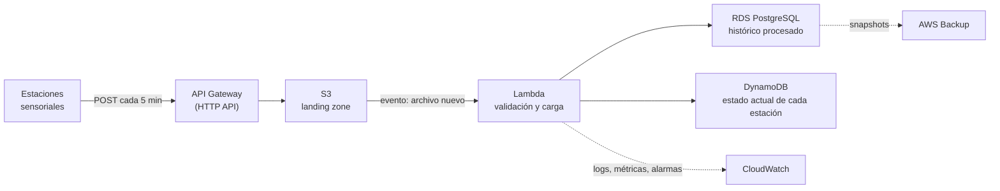
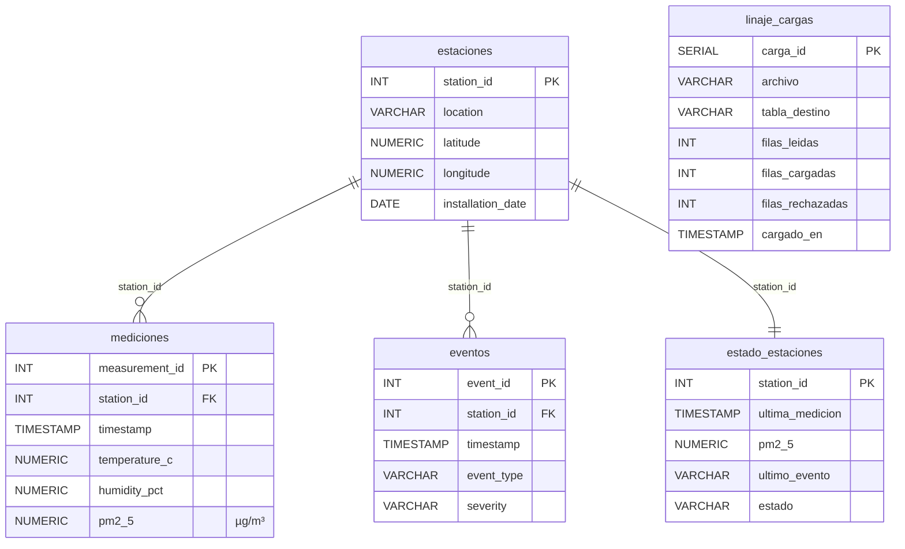

# Lecture 9: arquitectura en la nube con AWS (caso GreenSense)

<div align="justify">

Práctica del Módulo 2 de Henry Data Science. GreenSense opera estaciones sensoriales en ciudades de América Latina que miden temperatura, humedad y partículas finas (PM2.5), y registran eventos críticos como desconexiones o alertas por contaminación. Necesita pasar de una arquitectura manual y local a una en la nube que escale, esté disponible 24/7, automatice la ingesta, alerte ante eventos críticos y registre el linaje de los datos.

> **Homework:** el homework de esta lecture es el **Avance 4 del Proyecto Integrador** del módulo (FleetLogix), que está en su propio repositorio: [ProyectoM2_LauraGarmendia](https://github.com/laroga007/ProyectoM2_LauraGarmendia). Esta carpeta contiene la práctica de la lecture.

El trabajo tiene tres partes:

1. El **diseño** de la arquitectura en AWS.
2. Una **maqueta local** que ejecuta la lógica de esa arquitectura con Python y PostgreSQL, sin crear recursos en AWS.
3. La **estimación de costos** con la AWS Pricing Calculator.

## Contenido

| Archivo | Qué es |
|---|---|
| `procesar_landing.py` | Procesa la landing zone: valida, carga, actualiza el estado de las estaciones, alerta y registra el linaje |
| `data/landing/estaciones.csv` | 3 estaciones: Buenos Aires, Lima y Santiago |
| `data/landing/mediciones.csv` | 4 mediciones del 1/8/2024 entre las 10:00 y las 10:15 |
| `data/landing/eventos.csv` | 2 eventos críticos |
| `requirements.txt` | Librería que necesita el script (`psycopg`) |
| `greensense_estimacion_aws.csv` | Estimación de costos exportada de la AWS Pricing Calculator |
| `capturas/` | Capturas de la ejecución, la base y la estimación |

## Arquitectura en AWS



| Componente | Servicio | Rol |
|---|---|---|
| Entrada de datos | API Gateway | Recibe las mediciones y los eventos que envían las estaciones |
| Almacenamiento inicial | S3 (landing zone) | Guarda cada envío tal como llega: es la capa cruda y el respaldo de lo recibido |
| Procesamiento | Lambda | Se ejecuta con cada archivo nuevo: valida, transforma y carga |
| Almacenamiento procesado | RDS PostgreSQL | Histórico de mediciones y eventos, para análisis y auditoría |
| Estado actual | DynamoDB | Una fila por estación con su última lectura y su estado, para consultas inmediatas |
| Monitoreo | CloudWatch | Logs de Lambda, métricas y alarmas (por ejemplo, PM2.5 alto o una estación sin datos) |
| Backups | AWS Backup y snapshots de RDS | Copias automáticas de la base procesada |

Cada pedido del caso se resuelve con un componente:

| Pedido | Cómo se resuelve |
|---|---|
| Escalar ante más estaciones | API Gateway, S3, Lambda y DynamoDB escalan solos; RDS se agranda cambiando el tipo de instancia |
| Disponibilidad 24/7 | Servicios administrados por AWS; S3 conserva lo recibido aunque falle el procesamiento |
| Automatizar ingesta y procesamiento | Lambda se dispara con cada archivo nuevo en S3 |
| Alertas ante eventos críticos | Regla de PM2.5 y eventos de severidad Alta o Media; en AWS, alarmas de CloudWatch |
| Linaje para auditoría | Tabla de cargas con archivo de origen, tabla destino y filas leídas, cargadas y rechazadas |
| Solución gobernada | Catálogo de datos (abajo) y acceso restringido por perfiles |

## Maqueta local

La lógica de la arquitectura se ejecuta en la computadora, sin cuenta de AWS:

| En AWS | En la maqueta |
|---|---|
| S3 (landing zone) | Carpeta `data/landing` |
| Lambda | `procesar_landing.py` |
| RDS PostgreSQL | PostgreSQL en Docker, base `greensense` |
| DynamoDB | Tabla `estado_estaciones` en la misma base |
| CloudWatch (alarmas) | Las alertas que imprime el script |

### Qué hace `procesar_landing.py`

1. Crea la base `greensense` y las tablas, si no existen.
2. Lee cada CSV de la landing zone, empezando por `estaciones`, porque las otras dos tablas dependen de ella.
3. **Valida cada fila:** que la estación exista, que la humedad esté entre 0 y 100, que el PM2.5 no sea negativo y que cada valor tenga el tipo correcto. Las filas inválidas se informan y no se cargan.
4. Carga las filas válidas. Si una fila ya estaba cargada, la saltea (`ON CONFLICT DO NOTHING`), así que el script se puede volver a ejecutar sin duplicar datos. Es lo que se espera de una función Lambda, que puede dispararse más de una vez con el mismo archivo.
5. Actualiza `estado_estaciones` con la última medición y el último evento de cada estación, y le asigna un estado: `DESCONECTADA`, `ALERTA_PM25`, `SIN_DATOS` u `OK`.
6. Muestra las alertas: mediciones con PM2.5 mayor a 15 µg/m³ y eventos de severidad Alta o Media.
7. Registra el linaje de cada carga en `linaje_cargas`.

El umbral de 15 µg/m³ es la guía de la OMS (2021) para el promedio de 24 horas. Con mediciones cada 5 minutos se usa como referencia: un sistema real compararía el promedio diario.

### Modelo



### Cómo ejecutarlo

Con el contenedor de PostgreSQL encendido en Docker Desktop, desde la carpeta de la lecture:

```bash
python3 -m venv .venv
source .venv/bin/activate
pip install -r requirements.txt

export PGPASSWORD='contraseña_de_postgres'   # la contraseña no queda en el código
python procesar_landing.py
```

### Resultados

| Tabla | Filas cargadas | Rechazadas |
|---|---|---|
| estaciones | 3 | 0 |
| mediciones | 4 | 0 |
| eventos | 2 | 0 |

**Alertas:**

- Lima, 10:05: PM2.5 = 18,5 µg/m³
- Santiago, 10:10: PM2.5 = 22,1 µg/m³
- Lima, 10:06: ALTA_CONTAMINACION (severidad Alta)
- Santiago, 10:11: SENSOR_DESCONECTADO (severidad Media)

**Estado actual de las estaciones:**

| Estación | Última medición | PM2.5 (µg/m³) | Estado |
|---|---|---|---|
| Buenos Aires | 10:15 | 11,0 | OK |
| Lima | 10:05 | 18,5 | ALERTA_PM25 |
| Santiago | 10:10 | 22,1 | DESCONECTADA |

Santiago figura como desconectada aunque su última medición también supera el umbral: la desconexión, registrada después de la medición, tiene prioridad, porque sin sensor no se sabe cuál es el valor actual.

**Linaje:** la segunda ejecución leyó las mismas filas y cargó 0, así que `linaje_cargas` muestra 6 cargas: 3 de la primera ejecución (3, 4 y 2 filas) y 3 de la segunda, sin filas nuevas.

## Catálogo de datos

| Tabla | Contenido | Unidades | Origen | Responsable | Acceso |
|---|---|---|---|---|---|
| estaciones | Ubicación y fecha de instalación de cada estación | Grados decimales | Alta manual de estaciones | Ingeniería de Datos | Analistas y científicos de datos |
| mediciones | Lecturas periódicas | °C, % de humedad, µg/m³ de PM2.5 | Cada estación sensorial | Ingeniería de Datos | Analistas y científicos de datos |
| eventos | Alertas y fallas registradas por las estaciones | Severidad: Alta, Media | Cada estación sensorial | Ingeniería de Datos | Analistas, científicos de datos y operaciones |
| estado_estaciones | Último estado conocido de cada estación | — | Calculado en cada carga | Ingeniería de Datos | Operaciones |
| linaje_cargas | Registro de cada carga | Filas | Generado por el proceso de carga | Ingeniería de Datos | Auditoría |

En AWS, este catálogo se mantendría en AWS Glue Data Catalog.

## Estimación de costos

Estimación hecha con la AWS Pricing Calculator: [ver estimación](https://calculator.aws/#/estimate?id=64bcb565c7d878b0822ed3796e1e572bba1d07c4). Los precios no incluyen la capa gratuita.

**Supuestos:**

| Supuesto | Valor |
|---|---|
| Región | US East (N. Virginia), la más económica. São Paulo daría menos latencia, pero un envío cada 5 minutos no la necesita |
| Estaciones | 50, como crecimiento desde las 3 actuales |
| Frecuencia | Una medición cada 5 minutos: 50 × 12 × 24 × 30 = **432.000 envíos por mes** |
| Tamaño de cada envío | 1 KB |

**Resultado: 17,59 USD por mes, 211,08 USD por año.**

| Servicio | Configuración | USD por mes |
|---|---|---|
| RDS PostgreSQL | db.t4g.micro, Single-AZ, 20 GB gp3, sin proxy | 13,98 |
| S3 | 1 GB Standard, 432.000 PUT y 432.000 GET | 2,36 |
| DynamoDB | Bajo demanda, 1 GB, 432.000 escrituras y lecturas | 0,55 |
| API Gateway | HTTP API, 432.000 solicitudes | 0,43 |
| Lambda | 432.000 ejecuciones de 200 ms con 128 MB | 0,27 |
| **Total** | | **17,59** |

CloudWatch y AWS Backup no se incluyeron: las métricas básicas de CloudWatch son gratuitas, y el almacenamiento de backups automáticos de RDS no tiene costo hasta el tamaño de la base.

### Decisiones de costo

- **RDS es el 79 % del costo.** Es el único servicio que cobra por estar encendido las 24 horas, aunque no reciba datos; los demás cobran por uso.
- **Sin proxy de RDS.** La calculadora lo traía activado y sumaba 21,90 USD por mes, más que la base misma. Sirve para administrar miles de conexiones simultáneas, algo que este volumen no necesita.
- **DynamoDB bajo demanda.** La opción de capacidad aprovisionada traía un costo inicial de 180 USD por reservar capacidad; bajo demanda cobra por cada escritura, igual que Lambda.
- **Lecturas eventualmente consistentes en DynamoDB.** Cuestan la mitad, y para consultar el estado de una estación alcanzan.
- **Los PUT de S3 son el 92 % de su costo** (2,16 de 2,36 USD). Si Lambda agrupara las mediciones y escribiera un archivo por minuto, en lugar de uno por medición, los PUT bajarían a 43.200 por mes y S3 costaría unos 0,25 USD.
- **Disponibilidad.** La configuración estimada es la mínima. Para la disponibilidad 24/7 que pide el caso, RDS iría en Multi-AZ (una réplica en otra zona), que aproximadamente duplica su costo.

## Capturas

| Captura | Qué muestra |
|---|---|
| [`greensense_procesamiento.png`](capturas/greensense_procesamiento.png) | Segunda ejecución del script: 0 filas nuevas, alertas y estado de las estaciones |
| [`greensense_modelo_dbeaver.png`](capturas/greensense_modelo_dbeaver.png) | Diagrama de la base `greensense` en DBeaver |
| [`greensense_linaje.png`](capturas/greensense_linaje.png) | La tabla `linaje_cargas` con las 6 cargas |
| [`greensense_estimacion_s3.png`](capturas/greensense_estimacion_s3.png) | Cálculo de S3 en la Pricing Calculator: el peso de los PUT |
| [`greensense_estimacion_resumen.png`](capturas/greensense_estimacion_resumen.png) | Resumen de la estimación con los 5 servicios |

## Ajustes y decisiones

- **Alcance:** la práctica del caso GreenSense no trae una consigna de entrega, porque el homework de la lecture es el Avance 4 del Proyecto Integrador. Se resolvió sin crear recursos en AWS, porque requiere una tarjeta de crédito asociada a la cuenta. La lógica de cada componente se ejecuta en la maqueta local y el costo se estima con la calculadora, que no necesita cuenta.
- **Tutoriales de instalación:** los de Airflow y Spark que acompañan la lecture no se usaron, porque la arquitectura del caso no los incluye. Quedan registradas dos diferencias con las versiones actuales, para cuando se usen:
    - el de Airflow indica los comandos de la versión 2.9 (`airflow webserver`, `airflow db init`), que cambiaron en la 3.x, la que se instala hoy;
    - el de Spark indica Java 11, pero Spark 4 requiere una versión más nueva.
- **Capa gratuita de AWS:** el tutorial menciona 12 meses gratis. Desde julio de 2025, las cuentas nuevas tienen un plan gratuito de 6 meses con hasta 200 USD en créditos.
- **Credenciales:** la contraseña de PostgreSQL se lee de una variable de entorno y no queda en el código ni en el repositorio.

## Alcance

Con 3 estaciones y 4 mediciones de 15 minutos, el trabajo es un **ejercicio de diseño y estimación**, no un análisis ambiental. Los supuestos de la estimación (50 estaciones, una medición cada 5 minutos) son una proyección para dimensionar la arquitectura.

</div>
